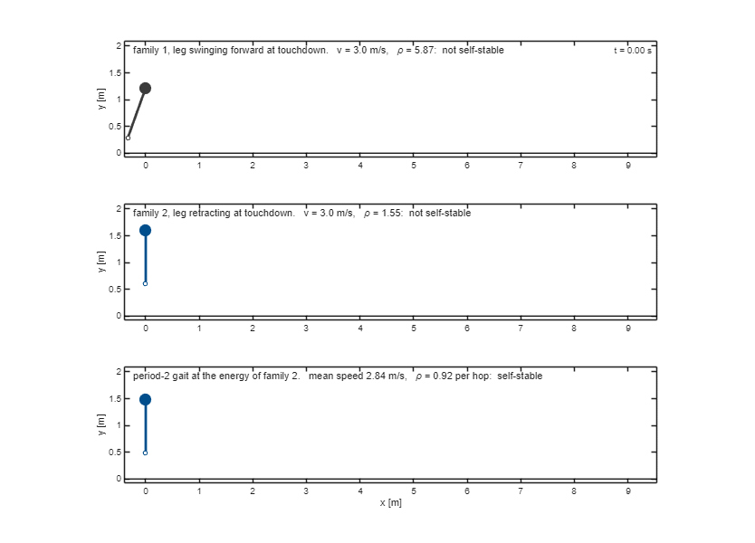

# Families of periodic motions of a spring-mass hopper

MATLAB code that computes the natural motions of a spring–mass hopper with a freely swinging leg, and
what a feedback controller can and cannot buy on each of them. One design of the hopper carries three
motions: two families of gaits, family 1 with the leg swinging forward at touchdown and family 2 with the
leg retracting, and the period-2 gait that family 2 hands over to when it stops being self-stable. At
2.0 m/s the body holds family 2 by itself (error growth per cycle ρ = 0.90, an error shrinks every hop)
and not family 1 (ρ = 2.68). The code computes the three motions, plots their error growth against
speed, animates them, and then runs a simple and a high-authority controller on each family with two
tests: the deepest pothole cleared, and the number of hops survived once the measurement is removed.

*The three motions at 3.0 m/s, five hops each at half speed, triangles at the apices. Family 1 is not
self-stable; family 2 is just past the speed where it stops being self-stable; the period-2 gait
alternates a low fast apex with a high slow one and is the motion the body holds here.*

## Run

Open `MAIN.m` and run it. Three settings at the top: `speeds`, the speeds of the controller comparison
(2.0 m/s by default); `nMC`, the number of runs in the dropout test (60 by default, 6 for a quick look, in
which the pothole column is unchanged); and `vanim`, the speed of the animation written to `gaits.gif`
(empty to skip). The random seed is fixed.

## The numbers at 2.0 m/s

| | pothole [cm] | dropout [hops] |
|---|---|---|
| family 2, controller off (`none`) | 18.0 | ≥ 40 |
| family 1, simple controller (`lqr`) | 5.0 | 0 |
| family 1, high-authority controller (`nmpc3x`) | 47.5 | 1 |
| family 2, simple controller (`lqr`) | 29.5 | ≥ 40 |

Peak leg force of the undisturbed gait: 56.5 N on family 1, 81.7 N on family 2.

`pothole`: deepest pothole cleared in a single landing, with the peak leg force capped at 1.5× the gait's
own peak. `dropout`: hops survived by all 60 runs on 0.5 cm rough ground once the measurement is removed
after hop 30; ≥ 40 means every run was still going when the test stopped at 40 hops. The simple controller
is a saturated LQR, the same one on both families; the high-authority controller is a one-step optimal law
with terrain preview at three times the actuator authority. `MAIN` prints six laws in all. The pothole
column moves with the controller; the dropout column moves only with the family.

## Files

| | |
|---|---|
| `MAIN.m` | the whole run: hopper, the three motions, their error growth, the animation, the controller comparison |
| `src/slip_hop.m` | one hop, the apex-to-apex map (vectorised, complex-step differentiable) |
| `src/slip_orbit.m` | a periodic gait as a fixed point of the map, by Newton |
| `src/slip_lin.m` | the linearised map: multipliers and actuator direction |
| `src/slip_arclength.m` | pseudo-arclength continuation through a fold |
| `src/slip_families.m` | the two families on the same hardware |
| `src/slip_period2.m` | the period-2 gait that family 2 hands over to |
| `src/slip_lqr.m` | the multiplier ρ and the LQR gain |
| `src/slip_control.m` | the controllers and the two tests |
| `src/slip_animate.m` | the animation of the three motions at one speed |

Model: massless-leg SLIP with swing-leg dynamics and the parameter values of M. Raff and C. D. Remy,
*Nonlinear Dynamics* 113, 8221–8247 (2025).
